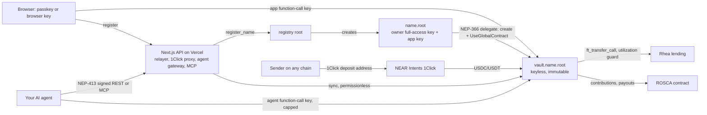

# Oiko

Oiko: **Personal finance meets personal intelligence.** Get paid from anywhere, plan every bit, and let your own AI agent help, on limits you set.

- Live demo (NEAR testnet): **https://oikodotnear.vercel.app**
- Built at NEAR HACKATHON 2026 (tracks: 08 Real-World Money `RWM` primary, 06 AI Security & Defense `SEC`, 07 Agent Economy `AGT`, 01 Unstoppable DeFi `DFI`)

## What it is

You claim a name (`ada.oiko.testnet`) and share a pay link. Anyone can pay that link, and every payment is split by your plan into pots: Spend, Bills, Savings, Goals and Locked. Money sits in a separate account (`vault.ada.oiko.testnet`) that holds no owner keys at all (only the capped agent keys it adds to itself) and runs code with no upgrade or admin method. Locks, plans and agent limits are enforced by that code, not by Oiko. Oiko has no built-in AI. You connect the agent you already use (over MCP or REST), and it can read, propose, or act only within caps the account enforces.

Why personal finance: payday is where people lose control of money. Oiko makes the plan run on every payment and lets an agent help without ever holding your keys.

Balances are USDC and USDT. USDC and USDT are stablecoins designed to track the US dollar. They are not dollars and are not bank deposits. They can lose their peg and issuers can freeze them.

## Try it

### On the hosted demo (no install)

1. Open https://oikodotnear.vercel.app/start, choose a name, pick "Keep me signed in on this browser" → you get `<name>.oiko.testnet` and a keyless savings account, with a default plan (Bills 30%, Savings 20%, Rainy day locked, one Goal).
2. Open `/pay/<name>` in a private window, choose "USDT on TRON", enter 100, a refund address, then "Simulate payment (test mode)" → status goes Waiting → Received → Delivering → Done, and the 100 USDT appears on Home split across your pots.
3. Try to withdraw from the locked pot → refused ("locked until …").
4. Withdraw 1 USDT from Spend → it leaves the account.
5. Agents → connect an agent with a cap → run it (see `examples/agents`) → payments within the cap pass, the next one is refused, Disconnect deletes its key.
6. Invoices → New invoice (client, a line or two, USDC or USDT, due date) → Create and get link → copy the link → open it in a private window → Pay this invoice → choose where the money is, give a refund address → "Simulate payment (test mode)" → back in Invoices the status goes Pending → Paid, with the amount received, the fee and a transaction link → Export CSV (one row per line item, ISO dates, plain decimals; also under Settings → Export invoices).

Note: the hosted demo pays for signups from a testnet relayer account. If signup says the account needs a top-up, the relayer is out of testnet NEAR (see `docs/STATUS.md`).

### From the command line (the same flow, scripted)

```bash
git clone https://github.com/devIykee/oiko && cd oiko
pnpm install
OIKO_API=https://oikodotnear.vercel.app pnpm smoke
```

`pnpm smoke` (`packages/sdk/scripts/smoke.mts`) runs the critical path against the live API and NEAR testnet and checks each step:

| Step | What it checks |
|---|---|
| register | relayer creates `<name>.oiko.testnet` |
| create account | `vault.<name>.oiko.testnet` is created by a relayed NEP-366 delegate and has **zero access keys** |
| plan | pots + split rules (Bills 40%, Rainy day 20%), Rainy day locked |
| get paid | 100 USDT "from TRON" via the 1Click proxy (test mode) → `sync()` credits it → ~40% lands in Bills |
| lock | withdrawing from the locked pot is refused with `E_LOCKED` |
| withdraw | 1 USDT leaves Spend |
| agent | an agent key with a 5 USDT cap reads, pays 2 + 2, the next payment is refused on-chain |
| revoke | revoke deletes the key from the account; the agent's reads are refused |
| cleanup | the test sign-in account is deleted and its NEAR returned |

### Run it yourself

```bash
cp .env.example .env        # point it at testnet contracts below, add your own relayer account + key
pnpm dev                    # http://localhost:3000
```

A zero-config local sandbox mode (`docker compose up`) was planned but is **not finished** (see Honest limits).

## Run the tests

```bash
pnpm test:unit        # 68 Vitest tests: SDK (NEP-413, amounts, insights), API server (gateway auth, relayer allow-list, 1Click mock), MCP, examples  (~2 s)
pnpm test:contracts   # cargo test: unit + proptest invariants + near-workspaces sandbox integration (critical path, ROSCA cycle)  (~2-3 min after first build)
node scripts/check-no-llm.mjs   # fails if any LLM SDK or LLM API host is in apps/, services/, packages/
node scripts/check-copy.mjs     # banned-words test for user-facing copy
```

## What runs where

| | Chain | Payments from other chains (1Click) | Earn (Rhea) | Tokens |
|---|---|---|---|---|
| hosted demo (`testnet`) | NEAR testnet, real contracts | built-in mock with the real 1Click request/response shapes (NEAR Intents has **no testnet**) | mock lending contract with Rhea's method names and JSON | mock USDC/USDT (NEP-141, 6 decimals) |
| `mainnet` | NEAR mainnet | real `https://1click.chaindefuser.com` (live minimum: 100 units) | real Rhea `contract.main.burrow.near` | native USDC, USDt |

Testnet contracts: registry `oiko.testnet`, `usdc.oiko.testnet`, `usdt.oiko.testnet`, `lending.oiko.testnet`, `ajo.oiko.testnet` (ROSCA savings), vault code published as a NEAR Global Contract with hash `3G9Gwhrtq8gN1ugLLNBShdjbw3s1imNH8FVrUXYWTPPR`, relayer `oiko-relayer.testnet`.

## Mainnet proof

Not run yet. Mainnet transactions need real funds and the human's go-ahead; nothing here was signed on mainnet.

| Step | Tx hash |
|---|---|
| register name | pending |
| create keyless account | pending |
| 1Click deposit (≥100 USDT) | pending |
| withdraw via 1Click | pending |
| Earn on Rhea | pending |

## Architecture



- **Identity account** `name.root`: holds your keys. Owner full-access key (from a passkey via WebAuthn PRF, or a browser key) plus an app function-call key that can call every owner method except `withdraw_large` and `rescue_sign`.
- **Savings account** `vault.name.root`: holds all money, has no keys except agent function-call keys it adds to itself (methods `agent_execute`, `agent_propose` only). No upgrade method: "upgrading" means moving unlocked money to a new account.
- **Agents** authenticate to the gateway with NEP-413 signatures from their own key; revoking the key on-chain ends both actions and reads. Caps (per transaction, day, week), allowlist, expiry and scopes are checked by the contract.

## NEAR features used

Named accounts and sub-accounts, Global Contracts (NEP-591, vault code by hash), NEP-366 meta transactions, function-call access keys with allowances, NEP-413 message signing, NEP-141/145 tokens, NEP-297 events, cross-contract calls with callbacks (sync, Earn, ROSCA), NEAR Intents 1Click, Rhea lending, chain signatures (`rescue_sign` via the MPC signer).

| Track | Fit |
|---|---|
| 08 Real-World Money `RWM` (primary) | pay-by-name from any chain, plan, bills, savings, locks, no seed phrase |
| 06 AI Security & Defense `SEC` | keyless account, immutable locks, scoped capped agent keys, NEP-413 gateway, one-tap revoke |
| 07 Agent Economy `AGT` | any agent manages money over MCP (stdio + HTTP) or REST, within on-chain budgets |
| 01 Unstoppable DeFi `DFI` | Earn on Rhea with an on-chain utilization guard (refuses above 92%) |

## Security model

Summary: Oiko holds no keys over user money, and the savings account holds no owner keys. The vault invariants listed in `docs/SECURITY.md` are property-tested in `contracts/vault/src/core.rs` and exercised in `contracts/tests`. Error codes: `contracts/ERRORS.md`. Full threat model and review findings: `docs/SECURITY.md`. Agent developers: `docs/AGENTS.md`. Details: `docs/DECISIONS.md`, `docs/interfaces/`.

## Honest limits

- Payments from other chains are simulated on testnet (no Intents testnet). Mainnet code paths exist but no mainnet proof has been run.
- Testnet uses mock tokens and a mock lending contract.
- No audit. Contracts are deployed on testnet only.
- Not finished: zero-config `docker compose` sandbox mode, Playwright e2e suite, Lighthouse reports, rescue sweeper UI, Invest (flagged off).
- The hosted demo stores nonces and the agent access log in Postgres (Neon). Without `DATABASE_URL` (e.g. a fresh local run) they are kept in memory per server instance.
- The agent connector has not been validated with users.
- Not a bank; balances are not insured; yields are variable and can go to zero; not investment, legal or tax advice. Rules for stablecoin yield products are still forming in many places.

## Built with

Next.js 16, React 19, Tailwind CSS 4, motion, Radix Dialog, qrcode, zod, near-api-js 7, @noble/curves + @noble/hashes, bs58, drizzle-orm + postgres (optional), web-push, @modelcontextprotocol/sdk, framework7-icons (MIT), Inter / Inter Tight, Acorn (display, supplied by the author); Rust near-sdk 5.29.1, near-contract-standards, near-workspaces, proptest, cargo-near; Vitest, Playwright, @resvg/resvg-js, opentype.js, svgo. Hosted on Vercel.

Code was written during the hackathon window with AI coding assistance (Claude Code). Libraries above are used under their own licences.

## License

MIT, see `LICENSE`.
