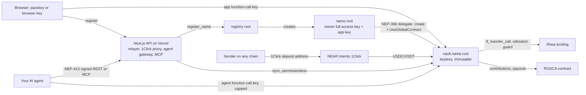

# Oiko

Oiko: **Personal finance meets personal intelligence.** Get paid from anywhere, plan every bit, and let your own AI agent help, on limits you set.

- Live demo (NEAR testnet): **https://oikodotnear.vercel.app**
- Demo video: **[oiko-demo.mp4](https://github.com/devIykee/oiko/releases/download/demo-video/oiko-demo.mp4)** ([release page](https://github.com/devIykee/oiko/releases/tag/demo-video))
- MCP package: **[oiko-mcp](https://www.npmjs.com/package/oiko-mcp)** on npm
- Built at NEAR HACKATHON 2026 (tracks: 08 Real-World Money `RWM` primary, 06 AI Security & Defense `SEC`, 07 Agent Economy `AGT`, 01 Unstoppable DeFi `DFI`)

## What it is

You claim a name (`steve.oiko.testnet`) and share a pay link. Anyone can pay that link, and every payment is split by your plan into pots: Spend, Bills, Savings, Goals and Locked. Money sits in a separate account (`vault.steve.oiko.testnet`) that holds no owner keys at all (only the capped agent keys it adds to itself) and runs code with no upgrade or admin method. Locks, plans and agent limits are enforced by that code, not by Oiko. Pot names, bill names and invoice details are encrypted on your device before they are saved (Veil), so neither the public record nor Oiko's server can read them. Oiko has no built-in AI. You connect the agent you already use (over MCP or REST), and it can read, propose, or act only within caps the account enforces.

Why personal finance: payday is where people lose control of money. Oiko makes the plan run on every payment and lets an agent help without ever holding your keys.

Balances are USDC and USDT. USDC and USDT are stablecoins designed to track the US dollar. They are not dollars and are not bank deposits. They can lose their peg and issuers can freeze them.

## Try it

### On the hosted demo (no install)

1. Open https://oikodotnear.vercel.app/start, choose a name, pick "Keep me signed in on this browser" → you get `<name>.oiko.testnet` and a keyless savings account, with a default plan (Bills 30%, Savings 20%, Rainy day 10% locked, one Goal 10%, Spend 30%). [e2e: README-1]
2. Open `/pay/<name>` in a private window, choose "USDT on TRON", enter 100, a refund address, then "Simulate payment (test mode)" → status goes Waiting → Received → Delivering → Done, and the 100 USDT appears on Home split across your pots. [e2e: README-2]
3. Plan → set Bills to 40% → get paid again → 40% of it lands in Bills. [e2e: README-3]
4. Try to withdraw from the locked pot → refused ("This pot is locked."). [e2e: README-4]
5. Withdraw 1 USDT from Spend → it leaves the account. [e2e: README-5]
6. Agents → connect an agent with a cap → run it (see `examples/agents`) → payments within the cap pass, the next one is refused, Disconnect deletes its key. [e2e: README-6]
7. Invoices → New invoice (client, a line or two, USDC or USDT, due date) → Create and get link → copy the link → open it in a private window → Pay this invoice → choose where the money is, give a refund address → "Simulate payment (test mode)" → back in Invoices the status goes Pending → Paid, with the amount received, the fee and a transaction link → Export CSV (one row per line item, ISO dates, plain decimals; also under Settings → Export invoices). [e2e: README-13]
8. Let a connected agent suggest a plan change (`propose_change`, or `POST /api/agent/change`) → it shows on Home under "Waiting for you" with the agent's reason → Approve → your plan changes. The same agent reads what happened with `get_events` and gets a `how_to_fix` on every refusal. [e2e: README-14]
9. Look your account up the way anyone can (`get_overview` on `vault.<name>.oiko.testnet`, or an explorer) → every pot name except Spend is a 38-character sealed label starting with 🔒; in the app you see "Bills", "Rainy day" and the rest. Settings → Privacy shows what is private and what is still public. An invoice link ends in `#k=…`: the payer's browser opens the details with it, and Oiko's server only stores ciphertext. [e2e: README-16]

Note: the hosted demo pays for signups from a testnet relayer account. If signup says the account needs a top-up, the relayer is out of testnet NEAR (see `docs/STATUS.md`).

### From the command line (the same flow, scripted)

```bash
git clone https://github.com/devIykee/oiko && cd oiko
pnpm install
OIKO_API=https://oikodotnear.vercel.app pnpm smoke
```

`pnpm smoke` (`packages/sdk/scripts/smoke.mts`) runs the critical path against the live API and NEAR testnet and checks each step:

| Step | What it checks |
|---|---|
| register | relayer creates `<name>.oiko.testnet` |
| create account | `vault.<name>.oiko.testnet` is created by a relayed NEP-366 delegate and has **zero access keys** |
| plan | pots + split rules (Bills 40%, Rainy day 20%), Rainy day locked |
| get paid | 100 USDT "from TRON" via the 1Click proxy (test mode) → `sync()` credits it → ~40% lands in Bills |
| lock | withdrawing from the locked pot is refused with `E_LOCKED` |
| withdraw | 1 USDT leaves Spend |
| agent | an agent key with a 5 USDT cap reads, pays 2 + 2, the next payment is refused on-chain |
| revoke | revoke deletes the key from the account; the agent's reads are refused |
| cleanup | the test sign-in account is deleted and its NEAR returned |

### Run it yourself (local, no keys, no testnet)

Everything runs on your machine: a NEAR sandbox with every Oiko contract deployed, the built-in test-mode payment provider, and the app. Nothing needs an account, a key or test NEAR.

With Docker:

```bash
cp .env.example .env
docker compose up            # first run builds the contracts (~15-20 min); then "oiko ready at http://localhost:3000"
```

Without Docker (needs Rust from `contracts/rust-toolchain.toml`, `cargo-near`, Node 22 and pnpm):

```bash
pnpm install
pnpm local                   # sandbox + contracts + app; prints "oiko ready at http://localhost:3000"
pnpm e2e                     # in a second terminal: the Playwright suite behind every e2e-tagged step above (~3 min)
```

Port 3000 busy? `PORT=3100 pnpm local` and `OIKO_E2E_URL=http://localhost:3100 pnpm e2e` (Docker: `OIKO_WEB_PORT=3100 docker compose up`).

The suite also covers: [e2e: README-7] a bill paid by an agent shows Paid; [e2e: README-8] Earn is refused when the lending pool is over 92% borrowed; [e2e: README-9] a 3-person ROSCA savings group with 1-minute rounds pays out; [e2e: README-10] reduced motion stops animations; [e2e: README-11] no sideways scrolling at 360 px; [e2e: README-15] clicking anywhere in a text box (padding, prefix or suffix), including the landing page's name box, focuses it.

To run the app against NEAR testnet instead, set `OIKO_NETWORK=testnet`, the contract names from "What runs where" and your own relayer account and key in `apps/web/.env.local`, then `pnpm dev`.

## Run the tests

```bash
pnpm test:unit        # 233 Vitest tests: SDK (NEP-413, amounts, caps, insights, Veil privacy), API server (gateway auth, relayer allow-list, 1Click mock exactly-once, invoices, receipts, agent events, change proposals, webhooks, how_to_fix, private invoices), sign-in codes, MCP (view keys), examples  (~20 s)
pnpm e2e              # 16 Playwright tests against `pnpm local` or `docker compose up`  (~3 min)
pnpm readme-check     # fails if an [e2e: …] marker in "Try it" has no matching test
pnpm test:contracts   # 49 cargo tests: unit + proptest invariants + near-workspaces sandbox integration (critical path, ROSCA cycle)  (~6 min including the wasm build)
node scripts/check-no-llm.mjs   # fails if any LLM SDK or LLM API host is in apps/, services/, packages/
node scripts/check-copy.mjs     # banned-words test for user-facing copy
```

Lighthouse (mobile): landing 86-89 performance / 100 accessibility, pay page 88-92 / 100, signed-in Home 89-91 / 100, best practices 100 and CLS 0 on all three. Reports: `docs/lighthouse/`.

## What runs where

| | Chain | Payments from other chains (1Click) | Earn (Rhea) | Tokens |
|---|---|---|---|---|
| hosted demo (`testnet`) | NEAR testnet, real contracts | built-in mock with the real 1Click request/response shapes (NEAR Intents has **no testnet**) | mock lending contract with Rhea's method names and JSON | mock USDC/USDT (NEP-141, 6 decimals) |
| `mainnet` | NEAR mainnet | real `https://1click.chaindefuser.com` (live minimum: 100 units) | real Rhea `contract.main.burrow.near` | native USDC, USDt |

Testnet contracts: registry `oiko.testnet`, `usdc.oiko.testnet`, `usdt.oiko.testnet`, `lending.oiko.testnet`, `ajo.oiko.testnet` (ROSCA savings), vault code published as a NEAR Global Contract with hash `72sdtZyfMEdLh2RSqSjBAPt73PpsHCr24irGCi9yahex` (accounts made before 2026-11-05 use the earlier `3G9Gwhrtq8gN1ugLLNBShdjbw3s1imNH8FVrUXYWTPPR`, and the app tells them), relayer `oiko-relayer.testnet`. The registry and ROSCA contracts have no keys left: nobody, including the team, can change them.

## Operator dashboard

Set `ADMIN_PASSWORD` and open `/admin` (unlinked, never indexed). After signing in you get:

- **Health checks:** RPC reachability and latency, storage (Postgres or in memory), relayer balance, the daily relayer budget, cron, the payment provider, and whether the registry and ROSCA contracts are still keyless.
- **Key numbers:** accounts, private-label adoption, accounts on the current account code (vs the earlier vault), relayer balance, money held by the newest accounts, invoices (and how many are private), agent requests and refusals in the last 24 h, and agent suggestions waiting for owners.
- **Signups chart** for the last 14 days, and a table of the newest accounts (code version, private labels, pots, bills, agents, balance).
- **Contracts and code:** access keys per contract, the published vault code and the registry's trusted list.
- The existing **public framing** switch.

It reads public chain data and aggregate counts only: no private labels, invoice contents or per-user agent logs. API: `GET /api/admin/dashboard`.

## Mainnet proof

Not run yet. Mainnet transactions need real funds and the human's go-ahead; nothing here was signed on mainnet.

| Step | Tx hash |
|---|---|
| register name | pending |
| create keyless account | pending |
| 1Click deposit (≥100 USDT) | pending |
| withdraw via 1Click | pending |
| Earn on Rhea | pending |

## Architecture



- **Identity account** `name.root`: holds your keys. Owner full-access key (from a passkey via WebAuthn PRF, or a browser key) plus an app function-call key that can call every owner method except `withdraw_large`, `approve_proposal_large`, `add_agent_large` and `rescue_sign` (those need the owner key).
- **Savings account** `vault.name.root`: holds all money, has no keys except agent function-call keys it adds to itself (methods `agent_execute`, `agent_propose` only). No upgrade method: "upgrading" means moving unlocked money to a new account.
- **Agents** authenticate to the gateway with NEP-413 signatures from their own key; revoking the key on-chain ends both actions and reads. Caps (per transaction, day, week), allowlist, expiry and scopes are checked by the contract.

## Your agent, on a budget

Oiko has no built-in AI. You connect the agent you already use (Claude, ChatGPT, Grok, your own code) and decide what it may do. The account's contract enforces those limits, not Oiko's servers.

- **Autonomous setup:** An agent can create its own Oiko account with zero human interaction. Generate an ed25519 keypair, prove key possession via NEP-413, `POST /api/agent/create-account` → get a name + vault. No passkey needed. Discovery: `/llms.txt`, `/.well-known/oiko-agent.json`.
- **Connect:** `npx -y oiko-mcp` (MCP over stdio, 0.2.0 on npm with all 20 tools), MCP over HTTP at `/api/mcp` (hosted assistants get a 24-hour link), or plain REST. Every request is signed with the agent's own key (NEP-413).
- **Read, suggest, act:** read balances, pots, plan, bills, invoices and ROSCA groups; propose payments for you to approve; or pay and move money on its own within per-payment, daily and weekly caps, only to people on its list.
- **Proactive:** `get_events` (or a signed webhook, or MCP notifications) tells the agent what happened: money in, bills due or missed, goals reached, Spend running low, invoices paid, its own cap at 80%, a weekly summary. Each event comes with suggested actions computed by code, which the agent can take, propose or pass on.
- **Proposals for everything:** besides money, an agent can suggest plan changes, new pots and goals, locks, Earn on/off, bills, savings schedules and draft invoices. You approve on Home; your own key carries it out.
- **Autopilot:** opt-in rules (top up Bills on every payment, pay bills on their due day, sweep Spend into savings weekly) that your agent runs inside its limits.
- **Every refusal explains itself:** `how_to_fix` tells the agent the next step, for example "use propose, or ask the owner to raise the weekly cap to at least 115.00".
- **Before paying anyone:** a counterparty check (account age, activity, code changes, shared scam reports) answers allow, warn or block.
- **Off switch:** Disconnect deletes the agent's key from your account; reads and actions stop at once.

Developer guide: `docs/AGENTS.md`. Discovery for agents: `/llms.txt`, `/.well-known/oiko-agent.json`.

## Private by default (Veil)

A public ledger is a strange place to keep a budget: anyone can look up an account and read its pots. Oiko's contract needs to see amounts, locks and payees to enforce your rules, but it never needs to know that a pot is called "Divorce lawyer" or a bill "Therapy". Veil keeps those labels private without changing the contract.

- **Sealed on your device.** Pot names and icons, bill names and agent reasons are encrypted (ChaCha20-Poly1305) in the browser before they are signed, and opened after they are read. The contract, RPC nodes, explorers and Oiko's server see only a token like `🔒䵁噒많…`.
- **Fits the contract already deployed.** The vault has no upgrade method and allows 40 characters per name. Veil writes 15 bits per character (base32768 over CJK and Hangul code points), so an authenticated, padded name is exactly 38 characters. Every existing account gets privacy with no migration. All names have the same length, so a token doesn't reveal how long the name is.
- **A view key, not a new password.** The key is derived from the owner key (HKDF), so every device you can sign in on derives the same key, and the server never sees it. It can read labels but cannot move money.
- **Agents, if you say so.** When connecting an agent, "Let it read private names" adds the view key to its connection string (or set `OIKO_VIEW_KEY` for `oiko-mcp`). The agent opens labels in its own process and seals the reasons it writes. Without the key it sees "Private".
- **Private invoices.** Client, email, descriptions and notes are encrypted with a per-invoice key that travels only in the link's `#fragment`, which browsers never send to the server. Amounts stay readable so payment works. Your CSV export is opened in your browser.
- **Backwards compatible.** No contract change, no API break. It works on accounts made with the earlier vault too (`scripts/veil-compat.sh`), plain names keep working, and agents, webhooks and push notifications from before Veil see "Private" instead of ciphertext. Clients that hold the view key opt in with `X-Oiko-Labels: sealed`. Old sign-in codes and connection strings still work.
- **Honest about the rest.** Amounts, timing, pot kinds, plan percentages, locks and payees stay public because the contract enforces them. The app lists these under Settings → Privacy → "Still public".

Design, threat model and references: `docs/PRIVACY.md`. Full implementation guide (formats byte by byte, worked example, key lifecycle, every code path and test): `docs/PRIVACY-IMPLEMENTATION.md`.

## NEAR features used

Named accounts and sub-accounts, Global Contracts (NEP-591, vault code by hash), NEP-366 meta transactions, function-call access keys with allowances, NEP-413 message signing, NEP-141/145 tokens, NEP-297 events, cross-contract calls with callbacks (sync, Earn, ROSCA), NEAR Intents 1Click, Rhea lending, chain signatures (`rescue_sign` via the MPC signer).

| Track | Fit |
|---|---|
| 08 Real-World Money `RWM` (primary) | pay-by-name from any chain, plan, bills, savings, locks, no seed phrase |
| 06 AI Security & Defense `SEC` | keyless account, immutable locks, scoped capped agent keys, NEP-413 gateway, one-tap revoke, client-side encrypted labels and invoices (Veil) with a read-only view key |
| 07 Agent Economy `AGT` | any agent manages money over MCP (stdio + HTTP) or REST, within on-chain budgets |
| 01 Unstoppable DeFi `DFI` | Earn on Rhea with an on-chain utilization guard (refuses above 92%) |

## Security model

Summary: Oiko holds no keys over user money, and the savings account holds no owner keys. Oiko's server also holds no key that can read private labels or invoice details (`docs/PRIVACY.md`). The vault invariants listed in `docs/SECURITY.md` are property-tested in `contracts/vault/src/core.rs` and exercised in `contracts/tests`. Error codes: `contracts/ERRORS.md`. Full threat model and review findings: `docs/SECURITY.md`. Agent developers: `docs/AGENTS.md`. Details: `docs/DECISIONS.md`, `docs/interfaces/`.

## Honest limits

- Payments from other chains are simulated on testnet (no Intents testnet). Mainnet code paths exist but no mainnet proof has been run.
- Testnet uses mock tokens and a mock lending contract.
- No audit. Contracts are deployed on testnet only.
- Not finished: rescue sweeper UI, Invest (flagged off).
- Autopilot rules need a connected agent: Oiko holds no key that could run them for you, by design.
- The hosted demo stores nonces and the agent access log in Postgres (Neon). Without `DATABASE_URL` (e.g. a fresh local run) they are kept in memory per server instance.
- The agent connector has not been validated with users.
- Privacy covers labels, not amounts: balances, transfers, plan percentages, locks and payees are public on NEAR. Labels saved before Veil (or with it off) stay in the chain's history. A shared view key can't be revoked, and there is no key rotation yet (`docs/PRIVACY.md`).
- Not a bank; balances are not insured; yields are variable and can go to zero; not investment, legal or tax advice. Rules for stablecoin yield products are still forming in many places.

## Built with

Next.js 16, React 19, Tailwind CSS 4, motion, Radix Dialog, qrcode, zod, near-api-js 7, @noble/curves + @noble/hashes + @noble/ciphers, bs58, drizzle-orm + postgres (optional), web-push, @modelcontextprotocol/sdk, framework7-icons (MIT), web3icons, Acorn (headings and UI, licensed by the author), Chillax (supporting text, Fontshare free licence); Rust near-sdk 5.29.1, near-contract-standards, near-workspaces, proptest, cargo-near; Vitest, Playwright, @resvg/resvg-js, opentype.js, svgo. Hosted on Vercel.

Tools: Claude Code and Grok were used during development and testing. The product itself has no built-in AI (`node scripts/check-no-llm.mjs`). Libraries above are used under their own licences.

## License

MIT, see `LICENSE`.
