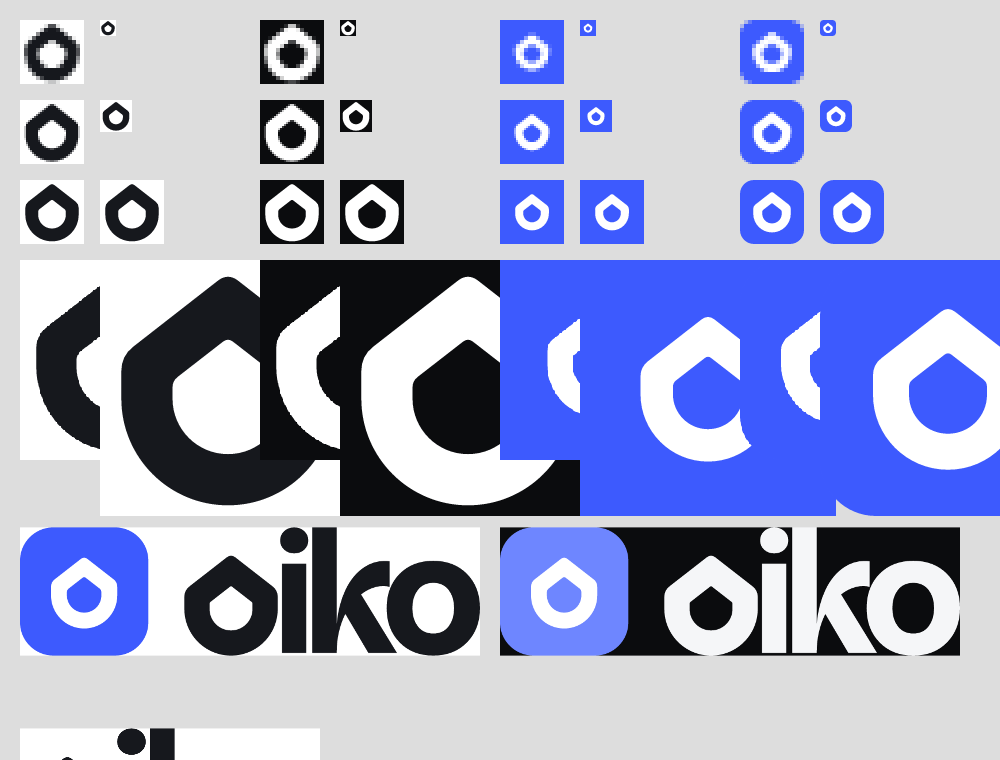

# Oiko brand

Oiko comes from the Greek *oikos*, "home". The mark is a **gabled o**: a bold, monoline lowercase o whose top rises into a house gable. It reads as the letter that starts the name and as a home for your money.



## Process

All geometry is generated from code (`scripts/`). Nothing is hand-drawn in an editor, so every export can be rebuilt.

1. **Three concepts** (`explorations/a-*`, `b-*`, `c-*`, each with a `-16` version tuned for 16 px). Contact sheets: `renders/sheet-concepts.png`, `renders/sheet-concepts-16.png`.
   - **A, roof ring**: thick o whose outer contour rises to a roof peak, round counter as a coin. *Rejected*: the roof lines are tangent to the circle, so it reads as a water drop or an upside-down map pin.
   - **B, tile with roof and coin**: rounded square, knocked-out roof chevron over a dot. Clean at 16 px but generic ("home button" of any app).
   - **C, home in the o**: round o with a house-shaped counter. Charming at 256 px, but the counter turns into a blob at 16 px and the ring is too heavy to work as a letter.
2. **Iteration 1** (`explorations/a2-*`, `c2-*`, `renders/sheet-iter1.png`): gave A overhanging eaves so it stops reading as a drop. It reads as a house now, but as a birdhouse (solid attic, round hole). C made letter-weight: still a "home button".
3. **Iteration 2** (`explorations/d*`, `renders/sheet-iter2.png`): the **gabled o**. Round base, short straight walls, gable roof meeting the walls at a *corner* (not a tangent), so it can't be read as a drop. D2 (monoline: the counter is the same gabled shape, inset) was clearly the strongest: it is an o first, a house second, and holds at 16 px.
4. **Iteration 3** (`explorations/e1-*`, `renders/sheet-iter3.png`, `renders/sheet-wordmarks.png`): tuned the stroke (4.4 / 4.8 / 5.0 on the 24 grid) and tested the gabled o as the first letter of the wordmark in Inter Tight Bold and Acorn Bold. Stroke **4.8** won: 3.2 px strokes at 16 px with a counter that stays open.

Checked against look-alikes: not a Revolut R, not Phantom's ghost (no wavy base, no eyes), not the NEAR N, not a location pin (point up, corners at the eaves).

## Final

- **Mark**: 24-unit grid, base circle r 10 at (12, 13), walls up to y 9, apex y 1.2, stroke 4.8, apex and eaves softened (r 1.2 / 1.4). One even-odd path, 294 bytes after SVGO.
- **Wordmark**: lowercase `oiko`, **Acorn Bold**, tracking −0.025 em, glyphs converted to outlines with opentype.js; the first o is replaced by the gabled o drawn at the font's own o width and stroke weight. 944 bytes. No fonts are needed to render it.
- **Colour**: monochrome first (ink `#16181D`, white). App icon: white mark on Oiko blue `#3D5AFE`, flat, no gradients.

### Type decision

- **Acorn Bold** (licensed, supplied in `/fonts`): the wordmark and the website's display headlines (hero, section titles, OG image). It is warmer and more personal than Inter Tight, and its soft terminals match the softened gable. Loaded with `next/font/local` from `apps/web/fonts` as `--font-acorn` and only used via the `mk-display` class and `font-brand`.
- **Inter Tight 600–700**: display inside the product (balances, headings) and smaller website headings (`font-display`).
- **Inter 400/500/600**: UI and body. Tabular numerals on all money.

## Exports

| File | Use |
|---|---|
| `oiko-mark.svg` | Mark, ink |
| `oiko-mark-mono-dark.svg` / `oiko-mark-mono-light.svg` | Mark, pure black / pure white |
| `oiko-wordmark.svg` / `oiko-wordmark-dark.svg` | Wordmark for light / dark backgrounds |
| `oiko-lockup-horizontal.svg` / `-dark.svg` | Blue app tile + wordmark |
| `oiko-app-icon.svg` | 512 px app icon, mark inside the maskable safe zone (80% circle) |
| `apps/web/app/icon.svg` | Favicon (rounded blue tile) |
| `apps/web/app/favicon.ico` | 16/32/48 PNG-in-ICO |
| `apps/web/app/apple-icon.png` | 180 px, full bleed (iOS rounds it) |
| `apps/web/public/icons/icon-192.png`, `icon-512.png`, `icon-512-maskable.png` | PWA manifest icons |
| `apps/web/app/opengraph-image.png` (+ `.alt.txt`) | 1200×630, flat, lockup + headline |
| `apps/web/components/brand/paths.ts` | Path data for `<Logo variant="mark \| wordmark \| lockup" />` (currentColor) |

Review renders at 16/32/64/256/1024: `renders/final-*.png`.

## Rebuild

```sh
node brand/scripts/concepts.mjs   # concept explorations
node brand/scripts/iter.mjs       # iteration 1
node brand/scripts/iter2.mjs      # iteration 2
node brand/scripts/build.mjs      # final exports, favicons, OG image, React paths
node brand/scripts/gen-f7.mjs     # website icon subset from framework7-icons (MIT)
```

Tooling (root devDependencies): `@resvg/resvg-js` (render), `opentype.js` + `wawoff2` (glyphs to paths), `svgo`, `@fontsource/inter-tight`, `@fontsource/inter`.

## Website

- Icons: framework7-icons (MIT) filled glyphs, inlined per-glyph (`apps/web/components/marketing/f7.tsx`, tree-shakable), plus the four custom Oiko glyphs (pay-by-name link, locked pot, agent with a budget, ajo circle) in `apps/web/components/icons/custom.tsx`, mirrored path-for-path from `packages/ui/src/icons/custom.tsx`.
- Closing illustration (`components/marketing/Door.tsx`): an open front door with a coin on the step; the roof repeats the gable, and the gable window is an o.
