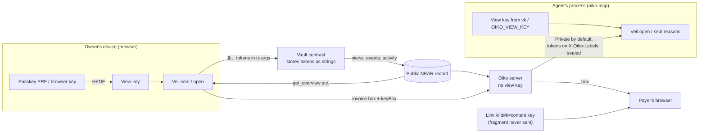

# How Oiko's privacy (Veil) is implemented

This is the engineering guide to **Veil**, the layer that keeps personal-finance labels in Oiko private on a public chain. It explains every format, key, code path and test, so someone new to the codebase can review it, change it safely, or reimplement it in another client.

For the short version (what is private, what is not, and why), read [`docs/PRIVACY.md`](PRIVACY.md) first. This document is the long version.

**Contents**

1. [Goals and non-goals](#1-goals-and-non-goals)
2. [Architecture at a glance](#2-architecture-at-a-glance)
3. [Cryptographic specification](#3-cryptographic-specification)
4. [Base32768: fitting a ciphertext into 40 characters](#4-base32768-fitting-a-ciphertext-into-40-characters)
5. [Worked example](#5-worked-example)
6. [The view key: derivation and lifecycle](#6-the-view-key-derivation-and-lifecycle)
7. [SDK: `veil.ts` and `VaultClient`](#7-sdk-veilts-and-vaultclient)
8. [Web app](#8-web-app)
9. [Private invoices](#9-private-invoices)
10. [Server](#10-server)
11. [Agents and MCP](#11-agents-and-mcp)
12. [Contracts: why nothing had to change](#12-contracts-why-nothing-had-to-change)
13. [Backwards compatibility](#13-backwards-compatibility)
14. [Operator dashboard and privacy](#14-operator-dashboard-and-privacy)
15. [Security analysis](#15-security-analysis)
16. [Testing](#16-testing)
17. [Operating and extending Veil](#17-operating-and-extending-veil)
18. [FAQ](#18-faq)
19. [File index](#19-file-index)

---

## 1. Goals and non-goals

**Goals**

- G1. Labels that describe a person's life (pot names and icons, bill names, the reasons an agent writes, and invoice client/description/note) are unreadable on the NEAR record, to RPC providers and explorers, and to Oiko's own server.
- G2. **No contract change.** The vault (`contracts/vault`) is deliberately immutable: no upgrade method, no admin, used by code hash. Any design that needed new contract code would reach only new accounts, after a redeploy.
- G3. The server never holds a key that can read labels.
- G4. No new secret for people to back up. Anything that can sign in as the owner can read their labels.
- G5. An owner can let a specific agent read labels without giving it anything else.
- G6. Everything that existed before keeps working: old accounts, old sessions, old agents, old links.

**Non-goals**

- Hiding amounts, balances, timing, counterparties, plan percentages, locks or agent limits. The contract must read these to enforce the owner's rules, and NEAR has no private state. Section 15 and `docs/ROADMAP.md` (3b) discuss what that would need.
- Hiding that an account uses Veil (tokens start with `🔒`).
- Erasing labels written before Veil. Chain history is permanent.

---

## 2. Architecture at a glance



The pattern throughout: **seal at the edge, open at the edge.** Plaintext exists only on the owner's device, in an agent the owner chose, and in the browser of an invoice payer who has the link. Everything in between (contract, chain, RPC, Oiko's server and database) handles opaque strings.

---

## 3. Cryptographic specification

All of this lives in `packages/sdk/src/veil.ts`.

### 3.1 Primitives

| Purpose | Primitive | Library |
|---|---|---|
| Encryption + integrity | ChaCha20-Poly1305 (RFC 8439), 256-bit key, 96-bit nonce, 128-bit tag | `@noble/ciphers` (audited, pure JS, synchronous) |
| Key derivation | HKDF-SHA256 (RFC 5869) | `@noble/hashes` |
| Randomness | `crypto.getRandomValues` (browser and Node ≥ 20) | platform |

**Why ChaCha20-Poly1305 and not AES-GCM via WebCrypto?** WebCrypto is asynchronous only, and labels are opened in many places (render paths, deep JSON walks, CSV rewriting) where a synchronous call keeps the code simple and fast. ChaCha20-Poly1305 is also constant-time in software, with no dependence on AES hardware.

### 3.2 Label token format

```
token     = MARK ‖ base32768( nonce ‖ ciphertext ‖ tag )
MARK      = "🔒" (U+1F512)
nonce     = 12 random bytes
plaintext = len_hi ‖ len_lo ‖ utf8(text) ‖ 0x00 … 0x00      (padded to the bucket size B)
ciphertext‖tag = ChaCha20-Poly1305.encrypt(key = view key, nonce, aad, plaintext)
aad       = utf8("oiko-veil/v1:" + vaultAccountId)
```

- **Length prefix**: 2 bytes, big-endian, the UTF-8 byte length of the text.
- **Padding**: zeros up to the bucket size. On open, every padding byte must be zero and the length must fit; otherwise the token is rejected.
- **Buckets** (padded plaintext sizes, prefix included): **40, 168, 488 bytes**. `seal(text, maxChars)` uses the smallest bucket that holds the text *and* whose token fits `maxChars`. If none fits, it throws `E_VEIL_TOO_LONG`. It never truncates.

| Bucket B | Raw bytes (12 + B + 16) | base32768 chars | Token length (with 🔒) | Max text (UTF-8 bytes) | Used for |
|---|---|---|---|---|---|
| 40 | 68 | ⌈544 / 15⌉ = 37 | **38** | 38 | pot names, pot icons, bill names, short invoice fields |
| 168 | 196 | ⌈1568 / 15⌉ = 105 | **106** | 166 | wrapped invoice keys, invoice client names and descriptions |
| 488 | 516 | ⌈4128 / 15⌉ = 276 | **277** | 486 | agent proposal reasons (contract limit 280), invoice notes |

### 3.3 Properties this gives

- **Confidentiality** of the label under the view key.
- **Integrity**: any change to any character fails the Poly1305 tag.
- **Account binding**: the vault account id is associated data, so a token copied into another account doesn't open (`tryOpen` returns `null`, `open` returns `"Private"`).
- **Unlinkability of equal names**: a fresh random nonce per seal means "Rent" sealed twice gives two unrelated tokens. Nobody can tell that two accounts both have a pot called "Rent", or that a pot was renamed back to an earlier name.
- **Length hiding within a bucket**: every pot and bill name is exactly 38 characters on chain.
- **Self-delimiting**: a fixed marker, three fixed lengths and a private alphabet mean tokens can be found inside any text (section 7.3).

### 3.4 Nonce budget

With random 96-bit nonces, the chance of a repeat after *n* seals under one key is about *n²* / 2⁹⁷. An account seals labels at human speed (dozens to a few thousand over its life), so the chance is around 10⁻²² even at 10,000 seals. A nonce repeat under ChaCha20-Poly1305 would leak the XOR of two plaintexts and weaken that key's authenticity, which is why the budget matters. It is nowhere near being a concern here.

### 3.5 Versioning

The string `oiko-veil/v1` sits in the associated data and `oiko/veil/v1` in the HKDF salt. A future format (new buckets, a new cipher, key rotation) uses `v2` strings and a different marker or token length, so old and new tokens can't be confused.

---

## 4. Base32768: fitting a ciphertext into 40 characters

The vault checks names with `check_text(field, s, 40, …)`, which counts **Unicode scalar values** (`s.chars().count()` in Rust), not bytes. A 38-byte name needs 68 bytes once sealed, which is 91 base64 characters. Far too many.

The trick (from qntm's *base32768*): if the limit counts characters, use characters that each carry more bits. Base32768 writes **15 bits per character**, two and a half times base64's six.

### 4.1 Alphabet

32,768 code points from three contiguous Basic Multilingual Plane blocks, chosen because every code point in them is assigned, printable, not combining, has no case mapping, and is unchanged by NFC/NFD/NFKC normalisation (so no layer "fixes" them in transit):

| Values | Code points | Block |
|---|---|---|
| 0 – 6,591 | U+3400 – U+4DBF | CJK Unified Ideographs Extension A (all 6,592) |
| 6,592 – 27,583 | U+4E00 – U+9FFF | CJK Unified Ideographs (all 20,992) |
| 27,584 – 32,767 | U+AC00 – U+C03F | Hangul Syllables (first 5,184 of 11,172) |

```ts
const R1 = 6592, R2 = R1 + 20992;
const toCp = (v) => v < R1 ? 0x3400 + v : v < R2 ? 0x4e00 + (v - R1) : 0xac00 + (v - R2);
```

All of these are BMP characters, so each is one scalar value (one `char` in Rust), one UTF-16 unit in JavaScript, and three bytes in UTF-8. Only the marker 🔒 is outside the BMP (two UTF-16 units). That matters for JavaScript `.length` checks on the server: a 38-character token has `.length` 39, a 277-character one 278, both within the server's limits.

### 4.2 Bit packing

Bytes are read most-significant bit first into an accumulator. Every 15 bits become one character. A final partial group is padded with zero bits on the right:

```ts
for (const b of bytes) {
  acc = (acc << 8) | b; bits += 8;
  while (bits >= 15) { bits -= 15; out += char((acc >> bits) & 0x7fff); }
  acc &= (1 << bits) - 1;
}
if (bits > 0) out += char((acc << (15 - bits)) & 0x7fff);
```

Decoding reverses this and stops after exactly the expected number of bytes. The expected length comes from the token's character count: 37, 105 or 276 body characters map to 68, 196 or 516 bytes. Any character outside the alphabet fails decoding.

### 4.3 Finding tokens inside text

```
VEIL_TOKEN_RE = 🔒[ALPHABET]{37}(?:[ALPHABET]{68}(?:[ALPHABET]{171})?)?      (flags: g, u)
```

This matches exactly the three token lengths. `isSealed(s)` is the same pattern anchored at both ends.

---

## 5. Worked example

Owner key from the seed `0x07` repeated 32 times, identity account `ada.oiko.testnet`, vault `vault.ada.oiko.testnet`:

| Step | Value |
|---|---|
| Owner public key | `ed25519:GmaDrppBC7P5ARKV8g3djiwP89vz1jLK23V2GBjuAEGB` |
| View key = HKDF-SHA256(seed, salt `oiko/veil/v1`, info `view:ada.oiko.testnet`, 32) | `oikoview1:jLefCApjWG4vkEftjdEZGSVeKZhEomy2WvT63knoNnk` |
| Fingerprint (safe to show) | `SvINIMp_iP` |
| `seal("Therapy")` (one run) | `🔒鈉焃姥뷳颏될䔬诣䌪絿꺇궸佁坞䮜蔙鍏帙벞胝꿥瘙腌璑䣐葸뷺뼿壶끉均灣䯂笐伵䕸㐀`, 38 characters |
| `seal("Therapy")` again | `🔒搬頋轐炂汢띳纻㭑몏詚抄煴뼬晎熇涆鄊㑜䀄걮㬺嫣払芼碅觡增偟丵肀庂劤瀅吖踗傐籀`, unrelated |
| `open(token)` | `Therapy` |
| `openText(token + " is due tomorrow")` | `Therapy is due tomorrow` |
| `encode32k([0x00, 0x01, 0x02])` | `㐀瓀` (U+3400 = value 0; U+74C0 = value 16,512 = the bits `100000010` followed by 6 padding zeros) |

What happens inside `seal("Therapy")`:

1. UTF-8 of "Therapy" is 7 bytes. 7 + 2 ≤ 40 and the 40-byte bucket's token (38 characters) fits the default limit of 40, so the bucket is 40.
2. Plaintext (40 bytes) = `00 07` ‖ `54 68 65 72 61 70 79` ‖ 31 zero bytes.
3. Draw a 12-byte nonce and encrypt with ChaCha20-Poly1305 under the view key, with AAD `oiko-veil/v1:vault.ada.oiko.testnet`. Result: 40 bytes of ciphertext plus a 16-byte tag.
4. 12 + 56 = 68 bytes, packed into 37 base32768 characters, prefixed with 🔒: 38 characters.

You can reproduce it:

```ts
import { Veil, keyPairFromSeed } from "@oiko/sdk";
const veil = Veil.fromOwnerKey(keyPairFromSeed(new Uint8Array(32).fill(7)).secretKey, "ada.oiko.testnet");
veil.exportViewKey(); // "oikoview1:jLefCApjWG4vkEftjdEZGSVeKZhEomy2WvT63knoNnk"
```

---

## 6. The view key: derivation and lifecycle

### 6.1 Derivation

```ts
viewKey = HKDF-SHA256(ikm = ownerSeed32, salt = "oiko/veil/v1", info = "view:" + identityAccountId, L = 32)
```

- `ownerSeed32` is the 32-byte ed25519 seed of the owner's full-access key on `<name>.<root>`. For passkey users it is `sha256("oiko-ed25519-seed" ‖ PRF output)` (`apps/web/lib/passkey.ts`), so it never touches storage; for "this browser" users it is the stored owner key.
- The identity account in `info` gives every account a different view key, even if two people ended up with the same seed.
- HKDF makes the view key independent of the signing key: knowing the view key reveals nothing about the owner key, and the view key cannot sign.

String form: `oikoview1:` + base64url (no padding) of the 32 bytes. Fingerprint: the first 10 base64url characters of `sha256("oiko-veil-fp" ‖ key)`. It identifies a key without revealing it.

### 6.2 Where the view key is created and kept (web app)

| Moment | Code | What happens |
|---|---|---|
| Sign-up (passkey or browser) | `apps/web/lib/signup.ts` | The owner secret is in memory to sign the vault-creation delegate; `viewKey` is derived and returned in the new `Session`. |
| Passkey sign-in on a new device | `session.tsx` `passkeySignIn` | The PRF gives the owner key, which signs the new app key; `viewKey` is derived in the same step. |
| "This browser" sessions saved before Veil | `session.tsx` `read()` | The session has `ownerKey` but no `viewKey`: it is derived and written back on load. |
| Passkey sessions saved before Veil | Settings → Privacy → "Unlock private labels" → `unlockPrivacy()` | One passkey prompt (`getOwnerKey`), then the key is derived and stored. |
| Move to another device | `lib/moveCode.ts` | `viewKey` travels inside the passphrase-encrypted code (PBKDF2 310k + AES-GCM). It falls back to deriving from `ownerKey` if the code has none. |
| Storage | `localStorage["oiko.session.v1"].viewKey` | Next to the app key, which already controls everyday money movement. It is never sent to Oiko. |
| Sign-out | `signOut()` | Removed with the session. |

`apps/web/lib/viewKey.ts` holds `viewKeyFor()` (derive + encode) and `veilFor()` (a small cache of `Veil` objects keyed by vault and key).

### 6.3 Sharing with an agent

The owner turns on "Let it read private names" in the connect flow (`components/app/ConnectFlow.tsx`). The connection string then carries `vk`:

```
oiko1:base64url({"api":"…","vault":"vault.ada.oiko.testnet","sk":"ed25519:…","vk":"oikoview1:…"})
```

Or the owner copies the key from Settings → Privacy, and the agent sets `OIKO_VIEW_KEY`.

---

## 7. SDK: `veil.ts` and `VaultClient`

### 7.1 Public API (`packages/sdk/src/veil.ts`)

```ts
class Veil {
  constructor(key: Uint8Array, vaultId: string)
  static fromOwnerKey(ownerSecretKey, identityAccountId, vaultId = "vault." + identityAccountId): Veil
  static fromViewKey(viewKey: "oikoview1:…", vaultId): Veil
  static capacity(maxChars = 40): number        // longest text (bytes) that fits a field
  seal(text, maxChars = 40): string             // idempotent: an existing token is returned as-is
  tryOpen(token): string | null                 // null: not a token, wrong key/vault, or tampered
  open(s): string                               // plain text passes through; unopenable tokens -> "Private"
  openText(s): string                           // opens every token inside a longer string
  openDeep<T>(v: T): T                          // deep copy of any JSON value with every string opened
  exportViewKey(): string; fingerprint(): string
}
isSealed(s); containsSealed(s); maskText(s); maskDeep(v); scalarLength(s)
deriveViewKey, encodeViewKey, decodeViewKey, viewKeyFingerprint
VEIL_MARK, VEIL_BUCKETS, VEIL_TOKEN_CHARS, VEIL_TOKEN_RE, VEIL_LIMITS, PRIVATE_LABEL
// boxes (section 9)
newBoxKey, sealBox, openBox, wrapBoxKey, unwrapBoxKey, encodeBoxKey, decodeBoxKey, BOX_PREFIX
```

Error codes `E_VEIL_TOO_LONG` and `E_VEIL_KEY` have plain-English messages in `packages/sdk/src/errors.ts`, so the app shows "That name is too long to keep private. Use at most 38 letters, or turn off private labels in Settings."

### 7.2 `VaultClient` integration (`packages/sdk/src/vault.ts`)

`VaultClient` takes a fourth constructor argument, `privacy?: Veil | "mask"`:

| Method | Sealed field(s) | Limit used |
|---|---|---|
| `createPot` | `name`, `icon` (non-empty) | 40 / 40 |
| `updatePot` | `name`, `icon` when given | 40 / 40 |
| `addBill` | `name` (the payee stays a real account) | 40 |
| `agentPropose` | `reason` | 280 |

Reads go through `this.v(method, args)`: with a `Veil` the result is `openDeep`-ed, with `"mask"` it is `maskDeep`-ed, and with nothing it is returned raw. This covers `overview`, `pot`, `bills`, `activity`, `proposals`, `agents` and `agent`. `splits` and `monthStats` carry no labels.

Because sealing happens inside the client, every caller (app screens, approving an agent's change proposal, the first-run pot setup) gets privacy without knowing about it.

### 7.3 Opening inside text

The server builds sentences from vault data it can't read (event titles, change summaries, `how_to_fix` hints). These contain tokens, for example `"🔒鈉焃… is due tomorrow"`. `openText` replaces each match of `VEIL_TOKEN_RE` with its plaintext (or "Private"), and `openDeep` applies that to every string in a JSON tree. A greedy match can't swallow a following word, because tokens use only the private alphabet and have fixed lengths.

---

## 8. Web app

| File | Role |
|---|---|
| `lib/viewKey.ts` | derive and encode the view key; cache `Veil` instances |
| `lib/privacy.ts` | `usePrivacy()` → `{ veil, reads, writes, state }`: `reads` = Veil or `"mask"`; `writes` = Veil only when Settings → Private labels is on; `state` = `on` / `off` / `locked` |
| `lib/data.ts` | every vault read hook builds `new VaultClient(rpc, vaultId, undefined, reads)`; query keys get `:open` when a key is present, so unlocking refetches |
| `lib/actions.ts` | `useMoney()` builds `new VaultClient(rpc, vaultId, signer, writes)`, so every write is sealed when privacy is on |
| `lib/owner.ts` | change proposals from agents are opened (or masked) with `openWith` |
| `lib/settings.tsx` | `privateLabels: boolean`, on by default |
| `components/app/PrivacySection.tsx` | Settings → Privacy: toggle, unlock, "Make existing pot names private", copy view key with fingerprint, "Still public" |
| `components/app/ConnectFlow.tsx` | "Let it read private names": adds `vk` to the agent's connection string |
| `app/(app)/bills/BillsScreen.tsx` | bill name input capped at 38 characters |

**"Make existing pot names private"** reads the raw overview (no Veil), picks pots that aren't Spend and aren't already sealed, and re-saves each one's name and icon through `updatePot`, which seals them. Bills have no update method on the vault, so their names change only when a bill is added again.

**Display of locked labels.** On a device without the key, `maskDeep` turns each token into "Private". `potIcon()` falls back to the pot kind's icon when the icon string isn't a known icon name, so masked icons still render.

---

## 9. Private invoices

Invoices are stored on Oiko's server (Postgres JSONB), not on chain, so they get a second scheme built on the same primitives (`apps/web/lib/sealedInvoice.ts`).

### 9.1 Format

```
contentKey = 32 random bytes                                   (one per invoice, reused on edit)
box        = "oikobox1:" + base64url( nonce12 ‖ ChaCha20-Poly1305(contentKey, nonce, aad, json) )
aad        = utf8("oiko-box/v1:invoice:" + ownerIdentityAccount)
json       = { fromName, client: { name, email }, items: [description…], note }
keyBox     = Veil.seal(base64url(contentKey), 120)             (a 106-character token under the view key)
link       = https://<host>/i/<invoiceId>#k=<base64url(contentKey)>
```

### 9.2 What the server stores

```jsonc
{
  "fromName": "🔒…",                  // Veil token if it fits the server's limit (80), else "Private"
  "client": { "name": "🔒…", "email": null },   // email only inside the box
  "items": [{ "description": "🔒…", "quantity": "2", "unitPrice": "60000000" }],
  "note": "🔒…",
  "token": "usdc", "dueDate": "2026-12-01",     // readable: needed to take payment
  "sealed": { "box": "oikobox1:…", "keyBox": "🔒…" }
}
```

The text fields hold view-key tokens so the owner's CSV export and agents with the view key can still read them. The box holds the canonical copy for the payer, who has no view key.

### 9.3 Flows

- **Create or edit** (`saveInvoice(session, input, id, veil, keyBox)`): `sealInvoiceInput` unwraps the existing `keyBox` when editing (so links already sent keep working) or makes a new content key, builds the box, seals the fields, and sends `sealed`. Server validation (`InvoiceSealedZ`): `box` starts with `oikobox1:` and is at most 64,000 characters; `keyBox` starts with 🔒 and is at most 200.
- **Owner list** (`useInvoices`): `openOwnerInvoice` unwraps `keyBox` with the view key, opens the box, overlays the real fields and sets `shareKey`. The sheet's link and "Open" button use `/i/<id>#k=<shareKey>`.
- **Payer** (`usePublicInvoice`): the hook reads `#k=` from `location.hash` (and on `hashchange`), fetches the public view (which carries `sealed: { box }` and never `keyBox`), and opens the box. Browsers never include the fragment in requests, Referer headers or server logs. Without the key the page shows "Private" and a note asking for the full link. Paying works either way.
- **CSV export**: the server's CSV has tokens as whole, unquoted fields. `openCsv` splits each line on commas (lossless, since a token contains no commas or quotes), opens each token, and re-applies RFC 4180 quoting and the spreadsheet formula guard (`'` before `= + - @`). It also restores the UTF-8 BOM that `Response.text()` drops.
- **Editing on a device without the key** is refused with a note, so the real details can't be overwritten with "Private".

---

## 10. Server

The server never opens labels. It does three privacy jobs.

**1. Validate and store sealed data** (`server/schemas.ts`, `server/invoices.ts`, `server/invoicesHttp.ts`): the optional `sealed` field described above.

**2. Shape output for readers who can't open labels** (`server/labels.ts`):

```ts
labelModeOf(req)   // "sealed" if the request has X-Oiko-Labels: sealed, else "masked"
forReader(v, mode) // masked: maskDeep(v); sealed: v unchanged
plainLabel(l, fb)  // for push notifications: the label if plain, else a neutral fallback
```

| Output | Where | Rule |
|---|---|---|
| `GET /api/agent/<tool>` | `agentHttp.ts` `agentRead` | `forReader(…, labelModeOf(req))` |
| `POST /api/agent/change` | `agentHttp.ts` | same |
| Hosted MCP (`/api/mcp`) | `mcp.ts` `InProcessBackend(ctx, labelModeOf(req))` | reads and `proposeChange` results |
| Webhooks | `webhooks.ts` `deliver` | masked unless registered with `labels: "sealed"` (or the registering request sent the header) |
| Bill reminders (web push) | `cron.ts` | `plainLabel(b.name, "A bill")` |
| Owner endpoints (`/api/owner/*`, invoices) | unchanged | the owner's app opens them itself |

The header is not part of the NEP-413 signature. It changes only how labels are shown, not what the agent may access.

**3. Tell agents how to behave**: `/llms.txt` (`server/discovery.ts`) and the MCP instructions (`packages/mcp/src/server.ts`) say that labels may be private, how to open them with a view key, and never to guess them.

---

## 11. Agents and MCP

`packages/mcp/src/gatewayBackend.ts` (oiko-mcp 0.3.0):

```ts
this.veil = conn.vk ? Veil.fromViewKey(conn.vk, conn.vault) : null;
read()          -> veil ? veil.openDeep(result) : maskDeep(result)
proposeChange() -> reason sealed (280) before sending; result opened
run(kind, …)    -> reason sealed before /api/agent/prepare, so the on-chain proposal reason is a token
```

`GatewayClient` (`packages/sdk/src/agent.ts`) adds `X-Oiko-Labels: sealed` to every request when the connection has `vk`. Agents without a key get "Private" from the server and from `maskDeep` (belt and braces).

`connectionFromEnv` (`packages/mcp/src/env.ts`) accepts `OIKO_VIEW_KEY` on top of `OIKO_CONNECTION`, or the `OIKO_AGENT_KEY` variables, and validates it (`E_VEIL_KEY`).

A custom agent does the same with the SDK:

```ts
import { GatewayClient, Veil, decodeConnectionString } from "@oiko/sdk";
const conn = decodeConnectionString(process.env.OIKO_CONNECTION!);       // may include vk
const client = new GatewayClient(conn);                                   // sends X-Oiko-Labels when vk is set
const veil = conn.vk ? Veil.fromViewKey(conn.vk, conn.vault) : null;
const ov = await client.get("/api/agent/overview");
const readable = veil ? veil.openDeep(ov) : ov;                           // without vk the server already says "Private"
```

---

## 12. Contracts: why nothing had to change

The contracts are untouched; only tests were added. Veil works because:

1. **Limits count characters.** The vault checks names at 40 and reasons at 280 Unicode scalar values (`check_text`, `add_bill_t`, `agent_propose_t`). A sealed name is 38, a sealed reason 277.
2. **Strings are opaque.** The vault never interprets a name: it stores it, returns it in views, copies it into NEP-297 events (`pot_created`, `bill_added`) and activity notes (`trunc(name, 40)` keeps all 38 characters).
3. **The JSON argument parser handles any UTF-8** (`contracts/common/src/args.rs`): raw multi-byte characters, `\uXXXX` escapes and surrogate pairs (`🔒` for 🔒). The earlier vault (`3G9G…`) uses near-sdk's serde, which handles them too.
4. **Storage cost is small.** A 38-character token is 3 × 37 + 4 = 115 bytes of UTF-8. At 10¹⁹ yoctoNEAR per byte that is about 0.001 NEAR per label, paid from the vault's own balance like any other state.

Tests that prove it against real code:

- `contracts/vault/src/tests.rs` → `veil_tokens_fit_and_round_trip_through_json_args`: VM-level test through the JSON wrappers, both raw UTF-8 and `\u` escapes; 41 characters is still refused.
- `contracts/tests/tests/veil.rs` → `sealed_labels_on_the_real_vault`: near-sandbox with the compiled wasm. It covers `create_pot` (app key), `update_pot` with escapes, `add_bill`, events, overview, activity, and the over-limit refusal.
- `scripts/veil-compat.sh`: builds the earlier vault from commit `67c925f` and runs the same sandbox test against it.

---

## 13. Backwards compatibility

The full matrix is in [`docs/PRIVACY.md` → Backwards compatibility](PRIVACY.md#backwards-compatibility). Implementation points:

- **Plain text is always valid input to `open`.** It passes through unchanged, so pre-Veil names, the fixed "Spend" pot, and names saved with the setting off all keep working.
- **`seal` is idempotent.** Re-saving a pot whose name is already a token doesn't double-seal it.
- **Optional fields only.** `Session.viewKey`, `AgentConnection.vk`, the invoice `sealed` field, `Webhook.labels` and the move-code `viewKey` are all optional. Readers that don't know them ignore them, and their absence means "behave as before".
- **Default-deny for ciphertext.** Anything the server sends to a reader that hasn't said it can open tokens gets "Private". That is why oiko-mcp 0.2.0, which is already published, needs no update to behave well.

---

## 14. Operator dashboard and privacy

`/admin` (`server/adminDashboard.ts`, `app/admin/Dashboard.tsx`) shows private-label adoption without reading any labels. `privacyOf(overview)` only asks `isSealed()` of each pot and bill name and reports `on` / `partial` / `off` / `none` per account. The dashboard otherwise shows public chain data (code hashes, key counts, balances) and aggregate store counts (`Store.adminCounts`). It has no per-user agent logs, no invoice contents and no labels.

---

## 15. Security analysis

| Adversary | Can they read labels? | Why |
|---|---|---|
| Anyone reading NEAR (explorers, indexers, RPC providers) | No | They see 38/106/277-character tokens; ChaCha20-Poly1305 under a 256-bit key they don't have |
| Oiko's server or database (breach or malicious operator) | No | It never receives the view key or a content key; invoice keys are in URL fragments |
| The owner's agent with `vk` | Yes, by design | The owner chose to share; the key can read, not sign or move money |
| The owner's agent without `vk` | No | Gets "Private" |
| Someone holding an invoice link | That invoice's details only | The content key is per invoice; it doesn't open other invoices or labels |
| Malicious front-end (supply chain, XSS) | Yes | It runs where plaintext exists. The same is already true for the app key (`docs/SECURITY.md`) |
| Someone who steals the view key | Every label sealed under it, past and future | No rotation yet (`docs/ROADMAP.md` 3b) |
| Tampering (changing a token on chain, swapping tokens between accounts) | Detected | The Poly1305 tag fails and the AAD binds the token to the vault id; the app shows "Private" |

**What still leaks.**
- The number of pots and bills.
- Which tokens share a bucket (all names are in the 40-byte one).
- That Veil is in use.
- Everything in the "Still public" list: amounts, balances, timing, payees, plan percentages, locks, pot kinds, colors, targets, agent policies.
- Pot `color`, which stays plain (16-character limit, and it carries little meaning).
- Names in agent change proposals until approval (the server validates them at 32 characters; the reason is sealed).

**Side channels considered.**
- Ciphertext length is fixed per field, so name length doesn't leak.
- Opening is not on any server path, so there is no padding oracle: a failed open just shows "Private" locally.
- The fragment key is not sent in Referer: browsers strip fragments from Referer.

---

## 16. Testing

| Layer | File | What it proves |
|---|---|---|
| Format and crypto | `packages/sdk/test/veil.test.ts` | base32768 round-trips and covers all 32,768 values and is NFC-stable; tokens are exactly 38 characters for any name ≤ 38 bytes; randomised; refuses instead of truncating; long buckets fit 280; deterministic view key per owner and account; agent key opens; wrong key, wrong vault and tampering fail; plain pass-through; `openText` and `openDeep`; masking; boxes and wrapped keys; `VaultClient` seals writes and opens reads |
| Contract (VM) | `contracts/vault/src/tests.rs` | real tokens through the JSON wrappers, escapes, limits |
| Contract (sandbox) | `contracts/tests/tests/veil.rs` | same against the compiled wasm; `scripts/veil-compat.sh` against the earlier vault |
| Private invoices | `apps/web/server/__tests__/privateInvoices.test.ts` | the server stores no secrets; owner opens; payer opens only with the fragment key; edits keep the link; the CSV opens with quoting and the formula guard intact; malformed boxes are refused |
| Compatibility | `apps/web/server/__tests__/labelsCompat.test.ts`, `apps/web/lib/__tests__/moveCodeCompat.test.ts`, `packages/mcp/test/mcp.test.ts` | masking by default, header opt-in, webhooks, push wording, old move codes, old connection strings, oiko-mcp opens and seals locally |
| Dashboard | `apps/web/server/__tests__/adminDashboard.test.ts` | privacy adoption is computed without passing any label through |
| End to end | `e2e/oiko.spec.ts` README-16, README-13 | the public record holds only tokens and the app shows names; the invoice server response has no client name, the payer link opens it, the CSV has it |

Run:

```bash
pnpm test:unit                 # includes every TypeScript test above
pnpm test:contracts            # VM + sandbox (needs cargo-near)
bash scripts/veil-compat.sh    # sandbox test against the earlier vault
pnpm local & pnpm e2e          # full stack
```

---

## 17. Operating and extending Veil

**Deploying.** Nothing on chain. Ship the web app, and publish oiko-mcp 0.3.0 so stdio agents can use view keys. Existing accounts get privacy on their next write, or immediately via "Make existing pot names private".

**Sealing a new field.**
1. Find the contract's limit for it and confirm a bucket's token fits (`VEIL_TOKEN_CHARS`).
2. Add the limit to `VEIL_LIMITS` and seal it in the matching `VaultClient` write method with `this.sealText(value, limit)`.
3. Reads need nothing: `openDeep` already opens every string.
4. If the server shows that field to outside readers, it is already covered by `forReader`. Check any push or other non-JSON text with `plainLabel`.
5. Add a test in `veil.test.ts` and, if it's a new contract method, a sandbox assertion in `contracts/tests/tests/veil.rs`.

**Key rotation (not built yet).** Derive a v2 key (new HKDF info, e.g. `view:v2:<account>`), open everything with the old key, re-seal with the new one (pots via `update_pot`; bills need an `update_bill` method in a future vault), and keep the old key for reading tokens still in events and history.

**Another client** (mobile, CLI) needs only `@oiko/sdk`: `Veil.fromOwnerKey` (or `fromViewKey`) plus `new VaultClient(rpc, vaultId, signer, veil)`.

---

## 18. FAQ

**Why CJK and Hangul characters instead of emoji or Latin letters?** We need 32,768 code points that are assigned, single code points, BMP, not combining and normalisation-stable. These three blocks are the largest contiguous ranges that meet all of that.

**Does an explorer show garbage?** It shows `🔒` followed by Chinese and Korean characters. The lock tells a reader it is intentional.

**Can someone guess a name by sealing candidates and comparing?** No. Sealing needs the view key, and even with it, random nonces mean the same name never gives the same token twice.

**What if a passkey can't do PRF?** Then the owner key can't be derived, so passkey sign-in already isn't possible there and the user uses "this browser" sign-in, which also gives a view key.

**What does an old version of the app show?** Raw tokens. The hosted app always serves the current version.

**Is Veil audited?** No. It uses audited primitives (`@noble/ciphers`, `@noble/hashes`) in a simple construction. See `docs/SECURITY.md`.

---

## 19. File index

| Path | Purpose |
|---|---|
| `packages/sdk/src/veil.ts` | format, keys, seal/open, masking, boxes |
| `packages/sdk/src/vault.ts` | `VaultClient` privacy argument; sealed writes, opened reads |
| `packages/sdk/src/agent.ts` | `vk` in connection strings; `X-Oiko-Labels` header |
| `packages/sdk/src/errors.ts` | `E_VEIL_TOO_LONG`, `E_VEIL_KEY` messages |
| `packages/mcp/src/gatewayBackend.ts`, `env.ts`, `server.ts` | agent-side opening and sealing; `OIKO_VIEW_KEY`; instructions |
| `apps/web/lib/viewKey.ts`, `privacy.ts` | view key and the `usePrivacy` hook |
| `apps/web/lib/session.tsx`, `signup.ts`, `moveCode.ts` | view key lifecycle |
| `apps/web/lib/data.ts`, `actions.ts`, `owner.ts` | opened reads, sealed writes, opened change proposals |
| `apps/web/lib/sealedInvoice.ts`, `invoices.ts` | private invoices, fragment keys, CSV opening |
| `apps/web/components/app/PrivacySection.tsx`, `ConnectFlow.tsx` | Settings → Privacy; sharing with an agent |
| `apps/web/server/labels.ts` | masking for readers without the key |
| `apps/web/server/agentHttp.ts`, `mcp.ts`, `webhooks.ts`, `cron.ts` | where masking applies |
| `apps/web/server/schemas.ts`, `invoices.ts`, `invoicesHttp.ts` | sealed invoice storage |
| `apps/web/server/adminDashboard.ts` | adoption stats without reading labels |
| `contracts/vault/src/tests.rs`, `contracts/tests/tests/veil.rs`, `scripts/veil-compat.sh` | contract-level proof, current and earlier vault |
| `docs/PRIVACY.md` | overview, what's public, compatibility matrix, references |
